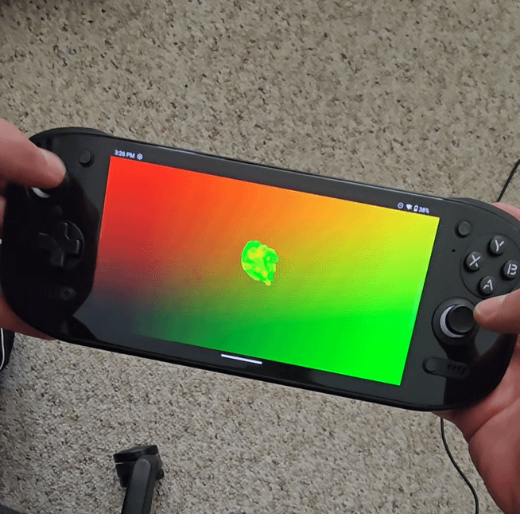
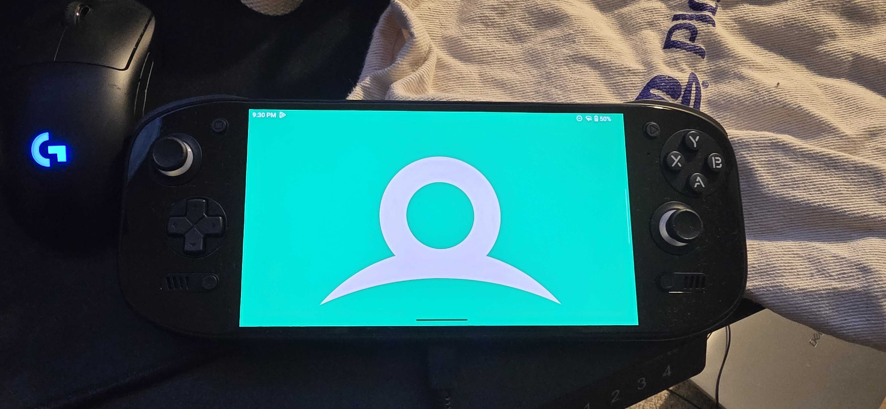
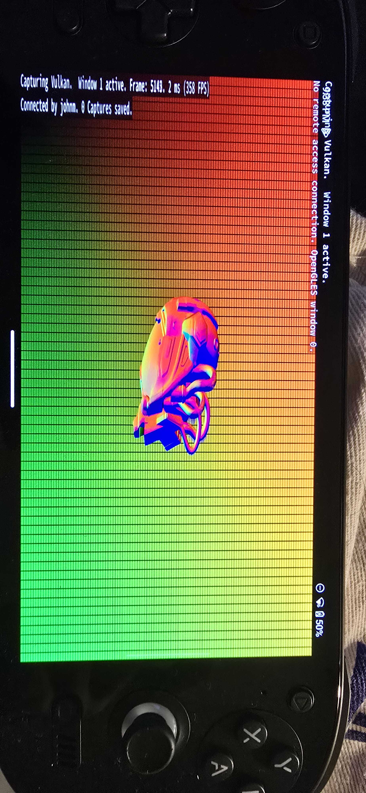
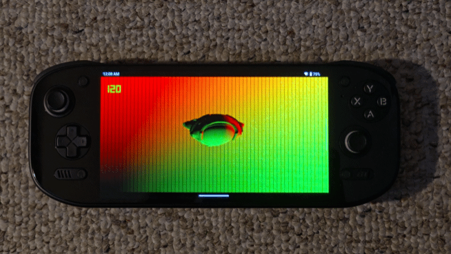

# Vulkan For Funsies Renderer

* this project is me trying to use only the spec to write a vulkan program after initially reading vkguide and then jumping off from there. no AI generated code but I'm ngl I eventually started asking AI questions when I ran into looking into resources and better understanding syncronization issues but its a hard-and-fast rule that none of the code itself be written by AI.
* started off trying not to use libraries, but then gave in to using VMA, volk, cgltf, and imgui because they were too useful to get this off the ground. Hand-rolling my own math library for fun though :)
* The sole purpose of this project is learning.
* model glb files are from Khronos sample assets (https://github.com/KhronosGroup/glTF-Sample-Assets). 

# Dependencies:
If running on Linux, please install the depedencies for SDL3: https://wiki.libsdl.org/SDL3/README-linux

Ensure that the Vulkan SDK is installed on your computer: https://vulkan.lunarg.com/
(if on Linux I found this useful: https://vulkan.lunarg.com/doc/sdk/1.4.357.0/linux/getting_started.html, make sure you follow the 
steps to add the needed things to your env on linux, I had to manually add the env
var to the cmake config since clion wasn't picking up on it.)

## 11/21/2026

* Made a really simple fly camera. Not super happy with how directly it is tied to the joysticks right now, but I think building out the input system would be a distraction at this point.
* also loaded in the uvs and packed that into the vertex data

## 11/18/2026
* showed off the handheld version and someone pointed out that the grid in the background was stretched out, so I took a capture in renderdoc to see if that could show it. It was actually easy to install and take a capture, but unfortunatly the capture looked normal and I knew it was an issue with the swapchain transform because everything was looking normal on linux / windows. 

So I found this article again (https://developer.android.com/games/optimize/vulkan-prerotation) which was great and saw that they were swapping the width height when in a 90 / 270 rotation. And my image seemed very stretched out so I tried swapping it the same as they did and that fixed the issue. My best understanding of what was happening was that when I said .preTransform = surfaceTransform, where the surfaceTransform was the one that the capabilities reported as the current transform, while also providing a swapped width and height, it went "ok, time to take the horizontal axis (say 1920) and map it to 1080 (giving you a very dense grid pattern along the horizontal axis of the "final" base swapchain orientation), and then take the vertical axis (say 1080) and then map that to 1920 (giving you the stretched out grid pattern). 

Issue pictured (device oriented along its identity swapchain transform which is somewhat unexpected that this thing is a vertical phone in a horizontal handheld body):

All of this was a bit confusing because the grid didn't have any rotation applied to it (compute shader), but the model did because I WAS applying the 90 / 270 rotation after the perspective matrix. All in all this is to say I hope it is a while before I have to deal with swapchain rotation again and if I do I should really read this article closer before implementing it.

## 11/17/2026 - 12:10 AM 
* Woooooo! got it finally working. I had written some asserts myself for handling the pretransform but managed to get that part working pretty quickly. Very exciting to see it on the android. here is a quick little gif:

* I think up next it would be awesome to write my own little fly camera using my matrix libraries and get that connected to SDL so it works on both PC and android. gonna merge this android progress into main.

## 11/16/2026

* talked with someone and I think that for now I can get away with uploading the mesh information to buffers and then just leaving it there forever. I don't think I'll need to unload mesh information for a bit but when it gets to that point I canfigure out what's up. 
* Going to spend today converting my buffer device address vertex pulling to using an SSBO provided via a descriptor set. this is because my android handheld doesn't support int64 soooo I need to find a way to write spirv shaders that don't need it.
* also got the feedback that the name "offscreen render target" is silly
* starting to realize with how I set things up that there is a "gpu work that needs to be done before first frame and after everything has been uploaded for setup" that doesn't exist right now
  * this would cover the staging buffer work that I have yet to do
  * would cover transitioning the depth buffer attachment to depth optimal only once at the beginning
  * would cover this one-time descriptor set update to point the descriptor to the uploaded mesh buffer
* another todo for me is to probably take out buffer device address stuff from this project cause like... I can't really use it on one of my main targets. I should also probably give this new structured buffer a name and take a capture.

# Entries below this are in reverse order heh

## 4/26/2026

* decided to go with creating my swapchain images in sRGB since that made the most sense to me for what would be least
  confusing in this project,
  which is mostly just trying to create my own personal sandbox renderer with imgui and such and not some crazy
  application that exists
  within a larger ecosystem.

## 5/2/2026

* decided to make the swapchain something that is a destination target, and has the exclusive sharing mode

## 5/7/2026

* learned that there are transforms on the swapchain that determine the "transform" that mainly handle mobile device
  rotation. just going to verify current transform is valid and pass that forward. if devices ever rotate (or the
  swapchain code is super inflexible) come back to this.
* for now just set the composite alpha to VK_COMPOSITE_ALPHA_OPAQUE_BIT_KHR since this is for rendering and we don't
  need it to be anything else for now
* I decided to go with clipping on the swapchain
* should probably read this if my device ever
  rotates: https://android-developers.googleblog.com/2020/02/handling-device-orientation-efficiently.html. decided not
  to
* read this if pre transform needs to be handled. for now, if not identity,
  assert: https://github.com/google/vulkan-pre-rotation-demo

## 5/12/2026

* going to make one command pool / buffer per swapchain image, just for drawing. wish me luck

## 5/14/2026

* decided against this since it made it more confusing and I don't care about multiple devices in this
  project: https://docs.vulkan.org/refpages/latest/refpages/source/vkAcquireNextImage2KHR.html

## 5/17/2026

* in the instance builder you quietly set the version to 1_3, but you should pass that in somewhere way higher level
  like "engine" so you can figure out that value later.
* Ok, when I get this tomorrow, I need to actually call vkGetDeviceQueue and do a little audit to make sure that I haven't accidentally used a raw int somewhere stupid instead of an actual handle that I should have gotten. Then I need to figure out that semaphore situation with the queue submit and then present. and then I need to add fences. much to do but should be easier than this image memory barrier stuff.

## 5/18/2026
* when you get back to this, make sure the per frame things are cleaned up, the semaphores per swapchain image are cleaned up, then figure out where you need the CPU to wait, and also just in general get your mind around the synchronization stuff.

## 5/23/2026
* coming back to this project, the two biggest things that are bothering me are:
  * the whole "clear" swapchain and write color (technically transfer color) is all within the engine. it should be structured as: "hey report back to me when you have something for the swapchain"
  * my swapchain doesn't rebuild itself ever... so it will be begging for release and i am currently ignoring it... it eats at my conscious 